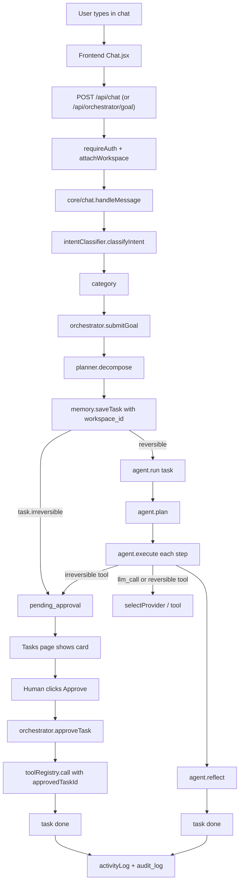

# Architecture

Plain-language overview, then the detail each developer needs.

---

## 1. The five layers

A request to CodeCraft travels through five layers:

1. **Frontend (React)** — the user types in chat or on a department page.
2. **Backend route** — authenticated API route accepts the request.
3. **Intent + orchestrator** — a classifier picks the right agent; the
   orchestrator queues a task row stamped with the workspace.
4. **Agent** — plans a sequence of steps, calls tools (model provider, web
   search, Gmail, etc.), and reflects on the result.
5. **Approval gate** — any irreversible step (send, delete, book) becomes a
   pending task until a human clicks Approve.

Every row carries a `workspace_id`. The scheduler runs the same orchestrator
flow on a timer for recurring workflows.

---

## 2. A request's journey

---

## 3. Modules

| Module | What it does |
|---|---|
| `backend/server.js` | Loads env, installs CORS, mounts routes in a specific order, loads plugins, starts Express, kicks off the scheduler |
| `backend/agents/registry.js` | Instantiates every agent and exports `getAgent(key)` |
| `backend/agents/base/BaseAgent.js` | `plan`/`execute`/`reflect`/`run` contract; `createApprovalTask` builds a pending task; every step emits an `activityLog` entry carrying `workspace_id` |
| `backend/core/orchestrator/index.js` | `submitGoal`, `approveTask`, `rejectTask`. On approval, dispatches the saved tool call with `approvedTaskId` so the Gmail guard can verify |
| `backend/core/intentClassifier.js` | Model-based category pick with ~15 labels + a keyword fallback so a model failure never invents a category |
| `backend/core/scheduler.js` | Ticks every 60 s; iterates due workflows per workspace; runs background jobs (response detection, follow-ups) if configured |
| `backend/core/workflowEngine.js` | Graph workflow runner — node types: trigger, agent, tool, condition, switch, decide, approval, loop, parallel, sub_workflow |
| `backend/core/pluginLoader.js` | Scans `backend/plugins/*/actions/*.js` and registers each with the tool registry |
| `backend/memory/MemoryStore.js` + `SupabaseStore.js` | Behaviourally identical in-memory + Supabase persistence |
| `backend/memory/workspaceGuard.js` | `Proxy` wrapper around the store that logs or throws on missing scope |
| `backend/core/workspaceContext.js` | Resolves `req.user.workspaceId`; `getSoleWorkspaceId()` for webhook paths with no logged-in user |
| `backend/core/sendGuard.js` | In test mode, refuses real sends on recognised Composio write slugs unless `ALLOW_REAL_SENDS=1` |
| `backend/plugins/gmail/guard.js` | Verifies every send carries `approvedTaskId` matching a real pending/approved task; dedups near-identical sends within 10 min; audits refusals |
| `backend/core/autoReplySafety.js` | Blocks WhatsApp/Telegram auto-replies on risk keywords, placeholders, daily caps, or model-judged ungrounded content |
| `backend/core/activityLog.js` | The single entry point for every audit event; respects workspace scope and system-caller allowlist |

---

## 4. Supabase tables

| Table | Purpose |
|---|---|
| `workspaces` | One row per tenant workspace |
| `workspace_members` | `(workspace_id, user_id, role)` |
| `workspace_connections` | Per-workspace integration credentials (reserved for Phase 2.5) |
| `business_profile` | Per-workspace business profile (reserved for Phase 2.4) |
| `roles`, `user_roles` | Role grants (`admin`, `client`) |
| `tasks` | Agent tasks; status, payload, `workspace_id` |
| `scheduled_workflows` | Simple interval/daily workflows (accessed via `saveWorkflow` / `listWorkflows` methods — table name differs from method name) |
| `workflow_definitions` | Graph workflows |
| `workflow_runs` | Execution history for `workflow_definitions` |
| `chat_messages` | Chat history |
| `audit_log` | Everything `activityLog.record` writes |
| `agent_memory`, `reflections` | Per-agent scratchpad and per-task notes |
| `outreach_threads` | Thread registry for Gmail guard ownership + dedup |
| `skills` | Universal Skill Installer registry |
| `long_term_memory` | Facts the user asked the assistant to remember |
| `briefing_runs`, `briefing_articles` | Snapshots and normalised articles for the Intelligence dashboard |
| `assistant_usage_daily` | Daily chat-spend accounting (for `ASSISTANT_DAILY_USD_CAP`) |
| `whatsapp_messages`, `telegram_messages` | Dedup store for inbound webhook messages |
| `rls_shadow_log` | Rows the Postgres trigger flagged for being out of workspace scope (Phase 1 shadow trigger) |

---

## 5. Workspaces (multi-tenancy)

One workspace = one business. Every row in every meaningful table carries a
`workspace_id`. Users attach to workspaces via `workspace_members`; on each
authenticated request, `resolveWorkspaceForUser(userId)` stamps
`req.user.workspaceId`.

### Shadow guard

`backend/memory/workspaceGuard.js` wraps the store in a `Proxy`. Every call
to a watched method is classified:

| Case | What happens |
|---|---|
| Scoped user call (`workspaceId` opt or `workspace_id` on the row) | Passes through |
| Named system call (`scope:'system'` + `systemCaller` in allowlist) | Passes through |
| Anything else | Logged (log mode) or thrown as `WorkspaceGuardError` (enforce mode) |

**Mode:** `WORKSPACE_GUARD_MODE` env, `log` (default) or `enforce`. Flip on
Render → Environment; no code redeploy needed. See
[operations.md § Flip the workspace guard](operations.md).

**Allowlist of 14 named callers:** `scheduler-tick`, `scheduler-migrate`,
`plugin-loader`, `startup`, `response-detection`, `outreach-pipeline`,
`auto-reply-safety`, `personal-assistant-system`, `briefing-agent-system`,
`installer-startup`, `workflow-engine-system`, `webhook-telegram`,
`webhook-whatsapp`, `test`. A `scope:'system'` call with any other
`systemCaller` is **refused** immediately.

### Workspace health panel

Settings → Workspace health reads `/api/workspace/shadow-log` and renders
each miss (`method`, `reason`, extras). Healthy state is empty aside from
expected scheduler reads. **Clear log** button wipes the file via
`POST /api/workspace/shadow-log/clear`.

### Phase status

| Phase | Status |
|---|---|
| 1 — schema, 14-table `workspace_id` columns, shadow RLS trigger | shipped |
| 2.1 — resolve + stamp workspace on login | shipped |
| 2.2 — shadow guard Proxy wraps the store | shipped |
| 2.3 (a–d) — stamp writes, scope reads, enforce mode, backfill, isolation test, post-backfill leak fixes | shipped |
| 2.4 — business profile per workspace | planned |
| 2.5 — per-admin connection credentials; re-enable "Add admin" | planned |
| 2.6 — enable Postgres RLS on all 14 tables; retire shadow log | planned |

### Why "Add admin" is disabled

Until Phase 2.5, every admin on the same server shares the same Gmail /
Composio / WhatsApp credentials. A second admin would gain full access to
the first admin's integrations. The UI disables the button; the server
returns `409` on `POST /api/team`.
