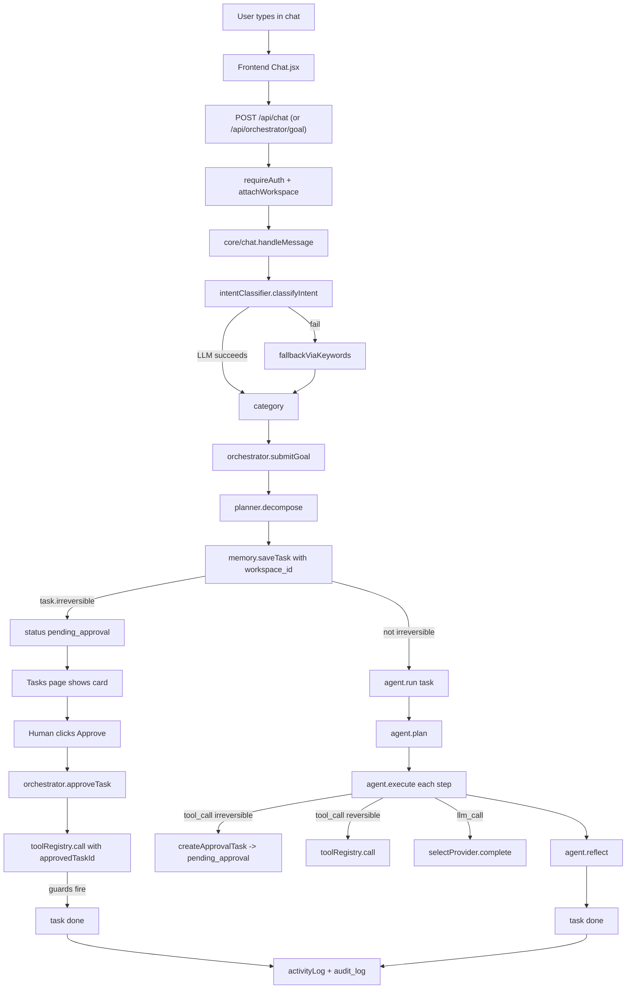

# Architecture

A plain-language overview, then the technical detail each developer needs to
extend the system without surprises.

---

## 1. Plain-language overview

A request to CodeCraft travels through five layers:

1. **Frontend (React)** — the user types in chat or on a department page.
2. **Backend route** — authenticated API route accepts the request.
3. **Intent + orchestrator** — a classifier picks the right agent; the
   orchestrator queues a task row.
4. **Agent** — the agent plans a sequence of steps, calls tools (LLM, web
   search, Gmail, etc.), and reflects on the result.
5. **Approval gate** — any irreversible step (send, delete, book) is deferred
   as a pending task until a human clicks Approve.

Everything is logged. Every row carries a `workspace_id`. The scheduler runs
the same orchestrator flow on a timer for recurring workflows.

---

## 2. A request's journey

---

## 3. Modules

### `backend/server.js`

- Loads env via `config/`, installs CORS (allowlist + `chrome-extension://`),
  `express.json({ limit: '35mb' })`.
- Hooks `uncaughtException` / `unhandledRejection` and collapses Supabase
  network noise so a transient DNS blip doesn't flood the log.
- Dev-only per-minute route counter (silent in prod).
- Calls `loadPlugins()` to register every plugin's actions in the tool
  registry.
- Mounts routes in a specific order (open webhooks first, then
  requireAuth-protected `/api`, then token-protected `/api/browser` and
  `/api/mcp`). See [api.md](api.md) for the full list.
- Starts Express, then kicks off `scheduler.start()` inside the `listen`
  callback.

### `backend/agents/registry.js`

Instantiates every agent and exports `getAgent(key)`, `registerAgent()`,
`unregisterAgent()` (the last two power the universal Skill Installer). All
agents extend `BaseAgent`.

### `backend/agents/base/BaseAgent.js`

The common contract: `key`, `role`, `goals`, `tools`, `plan()`, `execute()`,
`reflect()`, `run()`. Every meaningful step emits a structured
`activityLog.record` entry — never raw prompts/completions, just tool names
and metadata. Every log event carries `workspace_id` so the audit stays
scoped.

`createApprovalTask()` is the pattern every agent uses to defer an irreversible
action. It builds a UUID task with `status='pending_approval'`,
`irreversible=true`, `toolCall={ tool, irreversible: true }`, and a payload the
UI shows to the user.

### `backend/core/orchestrator/index.js`

Three functions:

- `submitGoal(goal, options)` → calls `planner.decompose()` → iterates tasks →
  saves each with `workspace_id` → either marks `pending_approval` (if
  irreversible) or calls `agent.run(task)`.
- `approveTask(taskId, options)` → verifies status, logs `human/task_approved`,
  dispatches the originally-requested tool with `approvedTaskId` (what the
  Gmail guard checks), flips to `done` or `failed`.
- `rejectTask(taskId, options)` → logs the rejection, marks the task
  `rejected`.

### `backend/core/intentClassifier.js`

Calls `selectProvider({}).complete(...)` with ~15 category labels and ~45
few-shot examples. Returns `{ category }`. On any LLM failure it falls back to
`fallbackViaKeywords()` which runs regex/keyword tests
(`isComputerOperationGoal`, `isBriefingGoal`, etc.) and then a keyword
classifier. **No** category is ever invented — a confused input lands in
`conversational` or `research`, not in `email_send`.

### `backend/core/scheduler.js`

- Ticks every 60 seconds.
- Each tick:
  1. `memory.listWorkflows({ scope:'system', systemCaller:'scheduler-tick' })`
     → filters by `isWorkflowDue()` → fires `runWorkflow(workflow)` for each.
  2. `memory.listWorkflowDefinitions(...)` → same for graph workflows.
  3. `tickOutreachAutomation()` → runs the response-detection and follow-up
     jobs if their configured intervals are > 0.
- Three schedule types: **interval**, **daily** (optional `daysOfWeek`), and
  **folder_watch** (graph workflows only — scans a configured folder for new
  video files).
- `runWorkflow(workflow)` wraps `orchestrator.submitGoal(workflow.goal,
  { workspaceId })`. `runGraphWorkflow(def, triggerOutput)` wraps
  `workflowEngine.runWorkflow(def.id, triggerOutput, { workspaceId })`.
- `runningIds` Set prevents overlapping runs of the same workflow.

### `backend/core/workflowEngine.js`

Graph-based workflow runner. Nodes: `trigger`, `agent`, `tool`, `condition`
(LLM yes/no), `switch`, `decide` (LLM picks from a curated menu, or `NONE`),
`approval` (pauses the run), `loop` (count or list, max 20 iterations), `parallel`
(up to the number of branches configured), `sub_workflow` (max depth 5).
Templates `{{nodeId.field}}` and loop vars `{{loop.item}}, {{loop.index}}` get
resolved before each node runs.

An `approval` node persists a `pending_approval` task with the paused
`workflow_runs.id` attached. The UI's Approve button resumes it via
`resumeWorkflow()`; Reject cancels it via `cancelWorkflow()`.

### `backend/core/pluginLoader.js`

On server start, scans `backend/plugins/*/actions/*.js` and registers each
action with the tool registry under `<plugin>.<action>`. Logs the loaded names.

### `backend/memory/`

- `MemoryStore` (in-memory, used in tests and when `CC_FORCE_MEMORY_STORE=1`).
- `SupabaseStore` (production — identical API, writes to Supabase).
- `workspaceGuard` — a Proxy that watches every write/list method, logs or
  throws on any call missing a workspace scope. See [workspaces.md](workspaces.md).
- `workspaceContext` — resolves `req.user.workspaceId` for authenticated routes
  (via `workspace_members`), and `getSoleWorkspaceId()` for webhook paths with
  no logged-in user.

### `backend/core/sendGuard.js`

Test-mode defence. If `CC_TESTING=1` and `ALLOW_REAL_SENDS!=1`, any Composio
action whose slug matches `_(SEND|POST|REPLY|UPLOAD|SUBMIT|CREATE|DELETE|UPDATE|REMOVE)_`
or is in the hard-coded `SEND_ACTION_SLUGS` list throws `SendGuardError` **before**
the HTTP call. No-op in production.

### `backend/plugins/gmail/guard.js`

Primary approval gate for Gmail. Every send must either:

- Carry `approvedTaskId` + match the stored task's `toolCall.tool` + match the
  stored recipient, or
- Be a system-digest (`systemDigest: true` + `to === config.applicant.email`
  exactly — anything else is refused).

Also: dedup by `(to, subject, sha256(body))` within a 10-minute window; writes
`memory.audit('gmail-guard', ...)` on every refusal (bodies hashed, never
logged in full).

### `backend/core/autoReplySafety.js`

Gate for inbound-message auto-replies (WhatsApp/Telegram). Blocks on:

1. Risk keywords (refund, cancel, complaint, legal, medical, suicide, etc.)
2. Placeholder patterns in the draft (literal `[bracket]`, `example.com`,
   `yourbusiness.com`, "lorem ipsum", etc.)
3. Daily per-channel send limit
4. LLM-judged "is this grounded in actual business knowledge" check — fails
   **closed** on any error.

### Inbox-triage filters

`PersonalAssistantAgent.filterMessages` drops:

- `fromEmail ∈ MY_EMAIL_ADDRESSES` (you're not replying to yourself)
- Threads already in `outreach_threads` (don't double-send)
- Subjects starting with `[CodeCraft` (system digests)
- Automated senders (`no-reply@`, `noreply@`, `mailer-daemon@`, `bounce@`,
  etc.)

Surviving messages are grouped by thread id and only the latest is kept.

### `backend/core/activityLog.js`

The single entry point for every audit event. Takes `(actor, action, target,
metadata)`. If `metadata.workspaceId` is present, scopes the write;
otherwise, if `metadata.scope === 'system'`, uses the named-system-caller
path; otherwise lets the shadow guard log the miss.

---

## 4. Supabase tables

| Table | Purpose |
|---|---|
| `workspaces` | One row per tenant workspace |
| `workspace_members` | `(workspace_id, user_id, role)` |
| `workspace_connections` | Per-workspace integration creds (reserved for Phase 2.5) |
| `business_profile` | Per-workspace business profile (reserved for Phase 2.4) |
| `roles` / `user_roles` | Legacy role grants (`admin`, `client`) |
| `tasks` | Agent tasks; status, payload, workspace_id |
| `scheduled_workflows` | Simple interval/daily workflows (saveWorkflow API) |
| `workflow_definitions` | Graph workflows |
| `workflow_runs` | Execution history for `workflow_definitions` |
| `chat_messages` | Ian chat history |
| `audit_log` | Everything `activityLog.record` writes |
| `agent_memory` | Per-agent scratchpad |
| `reflections` | Per-task notes written by `agent.reflect()` |
| `outreach_threads` | Thread registry for Gmail guard ownership + dedup |
| `skills` | Universal Skill Installer registry |
| `long_term_memory` | Facts the user asked Ian to remember |
| `briefing_runs` | Snapshots of each briefing agent run |
| `briefing_articles` | Normalized articles for the Intelligence dashboard |
| `assistant_usage_daily` | Daily LLM cost accounting (for `ASSISTANT_DAILY_USD_CAP`) |
| `whatsapp_messages` / `telegram_messages` | Dedup store for inbound webhook messages |
| `rls_shadow_log` | Rows the Postgres trigger flagged for being out of workspace scope |

> **TODO: confirm** — the `scheduled_workflows` table and the SupabaseStore
> methods named `saveWorkflow` / `listWorkflows` map to each other. This is
> intentional (shorter method names, more descriptive table name) but worth
> renaming on a future cleanup.

See `backend/database/schema.sql` for the full column list.
